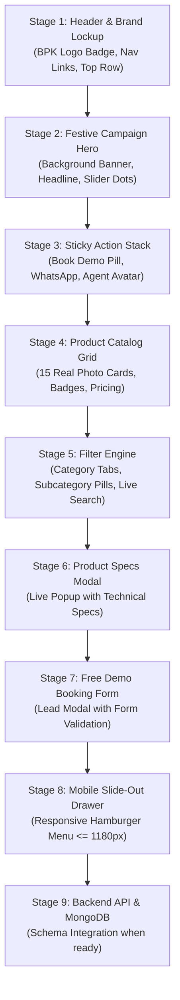

# Best Water Systems — Line-by-Line Development Plan

This plan guides our step-by-step, line-by-line construction of the **Best Water Systems** platform starting directly from the verified Frontend Mockup.

---

## 🎯 Development Roadmap

---

## 📑 Line-by-Line Component Breakdown

### 1. Stage 1: Header & Brand Lockup
- **File:** `documents/mockup/index.html` (lines 19–82) & `documents/mockup/style.css` (lines 40–180)
- **Goal:** Render the frosted glass brand badge with the official BPK water droplet logo, brand title, and horizontal category links.
- **Key Code Elements:**
  - `.brand-badge`: `backdrop-filter: blur(10px); flex-shrink: 0;` (prevents any overlapping).
  - `.header-divider`: 1px architectural gradient line.
  - `.cat-nav`: `Water Purifiers`, `Water Softeners`, `Mineral RO™`, `Alkaline RO`.
  - `.top-utility-links`: Trade Partner, Phone Helpline (`098427 25958`), About Us, Dealer Locator.

---

### 2. Stage 2: Festive Campaign Hero Banner
- **File:** `documents/mockup/index.html` (lines 85–115) & `documents/mockup/style.css` (lines 182–245)
- **Goal:** Display the high-resolution festive campaign backdrop matching Kent's festive campaign.
- **Key Code Elements:**
  - Headline: *"Begin the Festivities with Purity in Every Drop"*.
  - Subtext: *"Leaders in advanced RO technology for purity in every drop..."*
  - Interactive 3-dot pagination slider with smooth auto-cycle.

---

### 3. Stage 3: Sticky Floating Contact Stack
- **File:** `documents/mockup/index.html` (lines 118–137) & `documents/mockup/style.css` (lines 248–305)
- **Goal:** Fixed right-edge action buttons accessible from anywhere on the page.
- **Key Code Elements:**
  - `.demo-tab-pill`: Vertical "Book a Demo" tab.
  - `.whatsapp-circle`: Direct WhatsApp chat link (`https://wa.me/919842725958`).
  - `.agent-circle`: Support agent round avatar button.

---

### 4. Stage 4: Product Catalog Grid & Real Photo Cards
- **File:** `documents/mockup/index.html` (lines 140–205) & `documents/mockup/app.js` (lines 6–300)
- **Goal:** Render 15 authentic sample products with real `.webp` photographic images.
- **Key Products:**
  1. KENT Grand Plus Mineral RO™ (`images/kent-grand-plus.webp`)
  2. KENT Sapphire IoT Smart RO (`images/kent-sapphire-iot.webp`)
  3. KENT Supreme Alkaline RO (`images/kent-supreme-alkaline.webp`)
  4. KENT Prime Plus Digital RO (`images/kent-prime-plus.webp`)
  5. KENT Supreme Copper RO (`images/kent-supreme-copper.webp`)
  6. KENT Sterling Plus Under-Sink RO (`images/kent-sterling-plus.webp`)
  7. Best Ultima RO+UV 10L (`images/best-ultima-ro-uv.webp`)
  8. KENT Autosoft 25L Whole House Softener (`images/kent-autosoft-25l.webp`)
  9. KENT Autosoft 40L Villa Softener (`images/kent-autosoft-40l.webp`)
  10. KENT Compact Bathroom Softener (`images/kent-bathroom-softener.webp`)
  11. KENT Washing Machine Softener (`images/kent-washing-machine-softener.webp`)
  12. KENT Multi-Media Iron Removal Filter (`images/kent-iron-filter.webp`)

---

### 5. Stage 5: Interactive Category Filter Engine
- **File:** `documents/mockup/app.js` (lines 305–370)
- **Goal:** Instant client-side filtering without page reload.
- **Tabs:**
  - `All Products`
  - `💧 Water Purifiers`
  - `🚿 Water Softeners`
- **Subcategories:** `Mineral RO™`, `Alkaline RO`, `Digital Display RO`, `Whole House Autosoft`, `Bathroom Softener`.
- **Search & Sort:** Live text search and sort by Price / Rating.

---

### 6. Stage 6: Product Specifications Modal
- **File:** `documents/mockup/app.js` (lines 375–420)
- **Goal:** Popup modal displaying detailed technical specs, storage capacity, flow rate, inlet TDS, and dimensions.

---

### 7. Stage 7: Free In-Home Demo Booking Modal
- **File:** `documents/mockup/app.js` (lines 425–460)
- **Goal:** 1-click lead capture modal with pre-filled product name, address in Erode/Tamil Nadu, and phone number.

---

### 8. Stage 8: Mobile Slide-Out Drawer & Responsive Breakpoints
- **File:** `documents/mockup/style.css` (lines 480–540)
- **Goal:** Ensure flawless mobile experience `<= 1180px`, `<= 768px`, and `<= 480px`.
